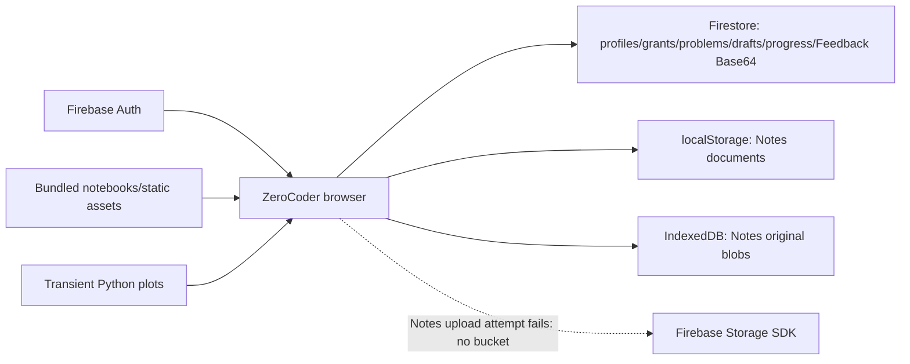
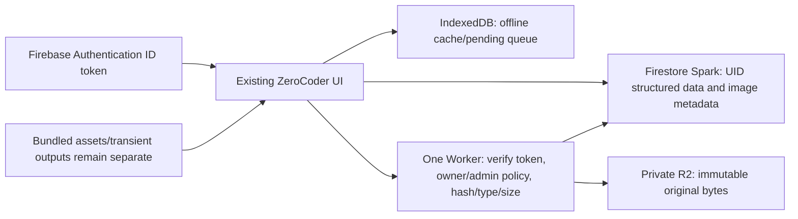

# Phase 1 — Database and storage audit

Status: **PASS for the read-only audit scope**. No application changes, cloud
configuration writes, data migration or production deployment were performed.
Implementation/security corrections are Phase 2 onward, not completed by this audit.

Baseline: `430e960` application plus Phase 0/0B documentation (`763f0c1`). Definitive
[Phase 1–6 plan](../plans/2026-11-09-firebase-r2-implementation.md).

## Evidence and scope

Current source was traced using GitNexus query/context, then checked directly.
The `zero_coder` index is four commits behind the pre-audit HEAD and omits restored
Notes, so source is authoritative for that feature. Graph context confirms
determineRole callers (registration, pre-login lookup, auth-state callback) and
Feedback compression called by submission. A suspicious unrelated `resolve` edge
in compression context is not treated as an actual runtime dependency.

Authorized production reads used the existing Firebase CLI OAuth account. The CLI
listed project `zerocoder-8cb6b` ACTIVE. Google REST observations began
**2026-11-09T16:22:54Z**. Only GETs and read-only Firestore collection-list/count
query POSTs were used. Tokens, personal account records, document contents and
private backups are not published. A sanitized snapshot remains privately at
`admin_backups/phase1-r2-audit/production-summary.json`.

Production database/root collection counts, rules, billing and Storage inventory
were actually read. Browser localStorage/IndexedDB contents, other devices, runtime
UI behavior and Cloudflare resources were not accessible/verified in this audit.
Local-store schemas below are code-defined, not counts of real browser data.

## Deployed services and configuration

| Service | Verified production observation | Interpretation |
|---|---|---|
| Firebase Authentication | API ENABLED; 17 accounts, one verified-email account, zero disabled accounts; zero `admin: true` custom claims | Existing email/password application auth; current admin identity is client-derived, not a trusted token claim |
| Cloud Firestore | One `(default)` database, Native/Standard, `nam5`, `freeTier: true` | Existing structured database on free tier |
| Billing | billingEnabled false, no billing account attached | No Blaze activation performed or required for the target design |
| Google Cloud Storage buckets | HTTP 200, empty bucket list, no next page | No project bucket exists; config's bucket string does not provision it |
| Firebase Storage API | DISABLED | Source upload attempts cannot establish a working production storage feature |
| Firestore deployed release | Updated 2026-08-24T17:16:41Z; permissive rules read successfully | Security correction is critical; production rules remain unchanged |
| Cloudflare Worker/R2 | Owner states not provisioned; no authorized Cloudflare inspection performed | BLOCKED for actual upload/download/deployment, never simulated as production |
| Repository deployment config | No tracked firebase.json, Firestore rules or indexes at baseline | Matching deployable configuration must be introduced and tested in Phase 2 |

Deployed rules allow public reads of users/authorized_emails, public read/write of
access_requests/password_reset_requests, any authenticated writes of users, and a
catch-all authenticated read/write for other paths. Overlapping allow rules are
additive: the catch-all also permits signed-in grant changes. Neither client route
guards nor hiding an admin button repairs server authorization.

## Actual root collections and schemas

Counts are exact aggregation results at observation time. All documents were
sampled for small collections; code_drafts and problems were sampled at 20 each,
so their field unions are not exhaustive. Root enumeration is not an assertion
that no uninspected subcollections or fields exist.

| Collection / identity | Actual count | Observed/code-defined fields and feature |
|---|---:|---|
| users / Auth UID | 17 | email, username, role, colorCode; optional createdAt string, adminLastViewedAt timestamp. Profile/auth/header consumers |
| authorized_emails / normalized email, plus bypass sentinel | 11 | code, addedAt, addedBy; bypassBlueCode on sentinel. Two Gray, two Blue, seven without code in live records. Admin grants and login membership |
| access_requests / email or random addDoc ID | 4 | email, username, requestedAt, requestedCode, status. Auth/AI/admin/notification workflows |
| feedbacks / random ID | 2 | userId, username, email, description, imageUrls, status, createdAt; optional adminReply, repliedAt, updatedAt, replies. User/admin Feedback |
| code_drafts / UID_problemId | 338 | uid, problemId string, code string. Coding/MCQ autosave/reset; flags remain browser-local |
| user_progress / UID | 10 | Dynamic problem ID → boolean map. Client-reported practice success; not a trusted assessment record |
| problems / problem identifier | 128 | id integer/string, title, category, description, testCases, initialCode, defaultCode, order, difficulty, hint in samples. Local course data merged with cloud problems |
| settings / legacy configuration | 1 | bypassBlueCode boolean. Not the current source's canonical bypass lookup; preserve until reconciled |

No root Notes collection appears in the deployed list. The source currently has no
Firestore Notes document writer. Future per-UID note/image metadata schemas are
Phase 2/3 designs, not deployed facts. password_reset_requests appears in deployed
rules but not the root collection inventory; modern source uses Auth reset email.

Source evidence: [AuthContext](../../../src/context/AuthContext.jsx),
[AdminPanel](../../../src/components/AdminPanel.jsx),
[FeedbackWidget](../../../src/components/FeedbackWidget.jsx),
[Workspace](../../../src/pages/Workspace.jsx),
[ProblemsContext](../../../src/context/ProblemsContext.jsx).

## Authentication and original Access Codes

| Code | Baseline behavior | Required preservation/security correction |
|---|---|---|
| Green | Hardcoded designated email derives Admin/Green; saved profile role/color can override derived values | Preserve Green admin experience only with trusted server-issued admin authorization; never grant admin because profile/code says Green |
| Blue | Full user access, AI, restricted 2809 practice category; hardcoded email/username matches and protected-looking email grants currently drive it | Preserve full membership; replace insecure editable/substring authority with reviewed grants; Blue is not admin |
| Gray | Basic workspace/course access; AI locked with Blue request UI; restricted 2809 category hidden/denied | Explicit Gray grant must survive bypass OFF and refresh; it must not become Red or gain admin/full features |
| Red | ProtectedRoute redirects to unauthorized | Preserve denial, request/upgrade flow and trustworthy revocation |

Live profile colors: six Blue, ten Gray, one Green. These are display/profile facts,
not proof of valid authorization: deployed rules permit profile edits. Existing
grants are also historically writable and need owner review before trusted release.
Zero actual token custom-admin claims means secure deployment needs an explicitly
confirmed owner UID and approved claim bootstrap; none was assigned in this phase.

AuthContext prioritizes stored role/color during login and pre-login account checks.
That helps retain Gray in one path but can retain revoked/stale privileges. Its
auth-state callback is not a live permission subscription. Pre-login profile and
username enumeration depends on public reads and must change with private rules.
ProtectedRoute checks only Red; application gates do not prove server enforcement.
See [ProtectedRoute](../../../src/components/ProtectedRoute.jsx),
[Auth](../../../src/pages/Auth.jsx), [AIAssistant](../../../src/components/AIAssistant.jsx),
[LearningAIChat](../../../src/components/LearningAIChat.jsx),
[Dashboard](../../../src/pages/Dashboard.jsx).

## Every identified image path

| Producer / feature | Current representation and repository | Quality / retrieval | Required action |
|---|---|---|---|
| Feedback file picker | FileReader → canvas → JPEG Base64 data URLs in feedbacks.imageUrls; legacy imageUrl display also supported | Long edge ≤800 px; JPEG quality 0.6; up to three files, picker rejects >5 MiB. User/admin modal displays data URL | New originals → R2, refs only in Firestore. Keep legacy rendering; migrate available bytes without another conversion |
| Notes file upload/drop | Original Blob in IndexedDB `zerocoder-note-images`, store `images`, UUID key | Record id/blob/extension/width/height/createdAt/owner, optional cloudPath; original saved before optional network upload | Preserve records until verified R2 upload and relationship migration |
| Notes clipboard file / pasted embedded Base64 HTML | Clipboard file or losslessly decoded data URL → same Notes image pipeline | PNG/JPEG/WebP/GIF; 10 MiB, 40 megapixel checks; HTML stores data-image-id, excludes runtime blob URL | Unified original-image service and explicit retry/offline status |
| Notes optional Firebase Storage attempt | Active dynamic firebase/storage import; path `notes/{uid}/images/{uuid}.{ext}`; 8-second timeout, local fallback | Original file passed to upload; only cloudPath saved in IDB. No bucket exists. Reader only reads IndexedDB; no cloud recovery | Remove runtime Storage path after preservation proof; keep IDB original and replace with R2 client in integration |
| Notes preview/edit | IndexedDB blob → object URL; UUID reference in sanitized HTML | Width/alignment/caption/alt are editor metadata; original bytes remain intact | UID-check reads and async callbacks; revoke URLs; recover originals remotely |
| Markdown ZIP export | Reads original IndexedDB blob bytes into ZIP assets | Exact available original; local document reference depends on same browser | Preserve behavior using R2/cache fetch; explicit missing-image errors |
| PDF/DOCX export | rasterImage helper → canvas capped at 2,400 px | PDF JPEG quality .92/white background; DOCX PNG conversion; PDF text replaces non-ASCII with ? | Phase 5 quality/Unicode corrections; export layout scaling must not downsample originals |
| Bundled notebook attachments / authored outputs | Base64 inside published .ipynb; rendered by NotebookViewer | Course/static assets, not user upload persistence | Keep bundled; do not migrate every published notebook image to R2 |
| Live Python/Matplotlib output | Python saves PNG to transient output; TerminalOutput/NotebookViewer render data URI | Generated execution output, not a persistent user image unless explicitly saved | Keep transient; a future explicit save must use shared R2 storage |
| Dataset images / logos / static illustrations | Bundled hosting URLs and FileBrowser previews | Static application/course assets | Keep hosting paths; do not duplicate as user originals |

Live Feedback inspection found exactly one stored image across the two sampled
documents: JPEG Base64 data URL, **4,367 encoded bytes / 3,256 decoded bytes**.
No HTTP image URL appeared in those records. Lost resolution/quality cannot be
recovered from that compressed JPEG. The original camera/screenshot file is not
present in Firestore. Actual Notes browser blob counts/bytes remain unverified.

Source: [notesImages](../../../src/utils/notesImages.js),
[Notes](../../../src/pages/Notes.jsx), [notesExport](../../../src/utils/notesExport.js),
[NotebookViewer](../../../src/components/NotebookViewer.jsx),
[TerminalOutput](../../../src/components/TerminalOutput.jsx),
[Python worker](../../../src/hooks/python.worker.js), [FileBrowser](../../../src/components/FileBrowser.jsx).

## Browser structured storage

Notes documents are arrays at `zerocoder_notes_{uid|guest}` in localStorage, with
id/title/content/createdAt/updatedAt/tags/source. HTML references image UUIDs;
positions live in separate localStorage keys. There is no cloud document sync.
The IDB owner field is set on write but getNoteImage does not validate it on read;
UID/account lifecycle and async image callbacks need explicit isolation tests.

Other browser keys include settings, active course/term/tool, recent navigation,
cached problems/cache version, flagged_problems, admin notification cursor, and
UID/problem/notebook-scoped AI history (plus sessionStorage compatibility history).
These UI caches are not an additional cloud database. Preserve them and course
behavior; do not accidentally migrate global flags into another account's notes.

## Dependency and migration requirements

1. **Security first:** deployed catch-all/public permissions and client-derived
   administrator identity are critical. Private rules require compatible auth,
   owner-only profiles and verified-email/UID grants. Emulator tests must cover
   all four codes and registration/reset/admin flows before approved deployment.
2. **R2 foundation:** one private Worker verifies Firebase tokens and ownership,
   controls safe canonical keys, validates type/size/hash, and stores metadata in
   Firestore. No public bucket or browser-held R2 secret. No extra database.
3. **Firebase Storage removal:** getStorage initialization and Notes upload are
   active source dependencies, not dead imports. Zero live project buckets and
   local-first writes establish no server originals to copy; preserve IDB blobs
   and cloudPath fields. Removing only the failed optional attempt is safe only
   with verified local retention/recovery and a tested replacement service.
4. **Notes migration:** backup raw localStorage arrays and account-owned original
   blobs before normalization; preserve tags/source/image layout and IDs. Guest
   import must be explicit. Digest/idempotency manifest, resume and conflict copies
   must survive offline restarts. Never delete source until verification.
5. **Feedback migration:** snapshot original image fields, decode exact available
   bytes, upload immutable originals, download/hash-check, then compare-and-swap
   attachment state before references change. Preserve legacy until finalized;
   image-only rollback must not overwrite later text/replies.
6. **Known compatibility risks:** LearningAIChat uses random request IDs while
   header/dismissal expects email IDs; user/admin replies rewrite whole arrays and
   can overwrite concurrent messages; settings/bypass locations differ; progress is
   client-reported practice. Fix within later designated phases, not this audit.
7. **Cleanup:** account for notes, revisions, legacy manifests and pending uploads;
   use dry-run/grace/recheck and race protection. Do not delete merely because one
   client removed an image from current HTML.

## Architecture diagram

Current baseline:

Target architecture (not yet implemented or provisioned):

## Acceptance, verification and next phase

All Phase 1 deliverables are source-backed: storage inventory/schema matrix,
four-code map, dependency and migration requirements, current/target diagrams and
the definitive plan. Production GET/query calls succeeded for project, Auth count,
database, all eight root collection counts, sampled schemas, rules, billing, bucket
list and three service states. No live data mutation was tested or performed.

Documentation/path validation passed (27 Markdown files, 75 local links, 12 skill
entries). Existing local image validation tests passed 2/2, with no network or data
writes. Source-only diff review confirms no application edits. App build/lint,
Emulator security tests, browser account/Notes
tests and production upload tests are **skipped / not claimed** for this read-only
phase; they belong to implementation gates. No shared browser exposes real local
stores. Private evidence remains ignored; no credentials or personal content are
included in the commit.

Independent read-only review checked current source and sanitized deployed evidence
and returned no Important or Critical findings. GitNexus change analysis and
staged whitespace checks completed without partial/truncated results or errors.

External gates: R2/Worker unprovisioned; no live trusted-admin claim; owner identity
and production deployment approval needed later. These block activation/migration,
not independent local Phase 2 development. Next: **Phase 2 only**, after delivering
this audit's isolated commit/report. Retrieve this report's checkpoint using
`git log -1 --format=%h -- docs/agents/reports/2026-11-09-phase-1-storage-audit.md`.
